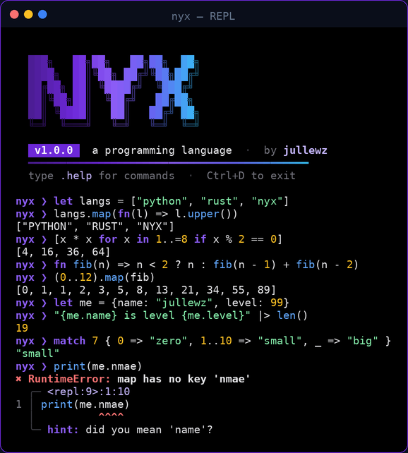
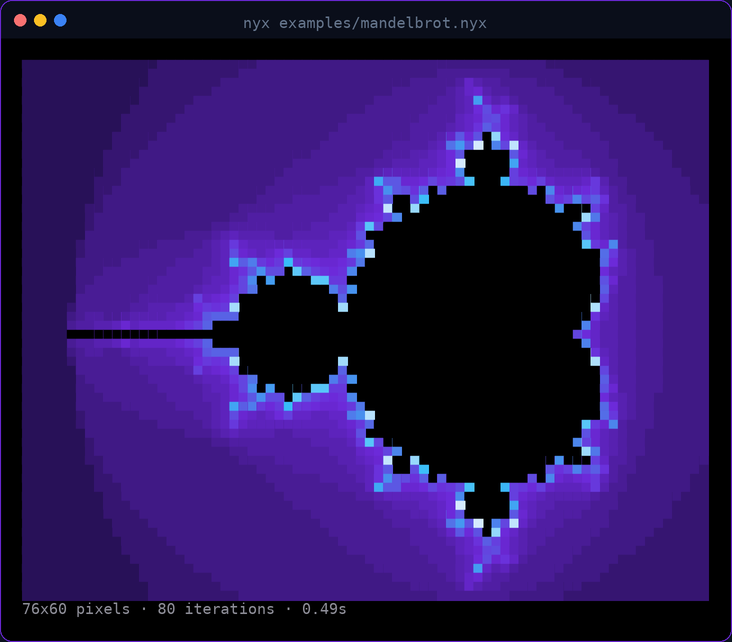
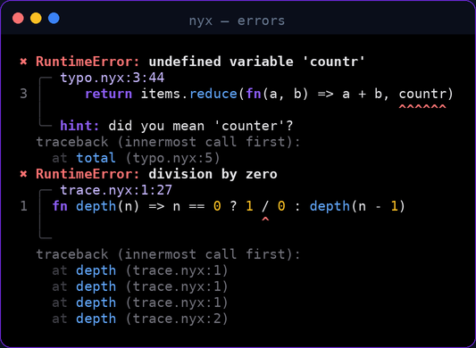
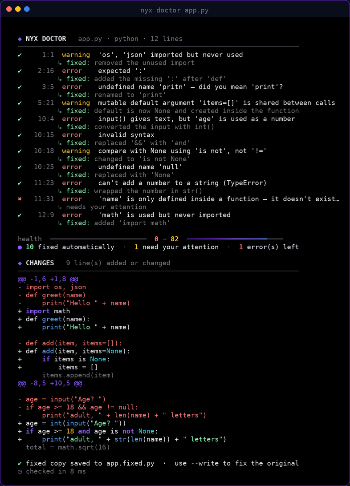

# NYX

<p align="center">
  
</p>

**A small, fast, dynamically typed programming language — written from scratch in pure Python by jullewz.**

NYX has its own syntax, lexer, parser and compiler, an interactive REPL, a standard library with 150+ functions and methods, modules, classes with inheritance, closures, pattern matching, list comprehensions, a pipe operator, and error messages that point at the exact character and suggest fixes. No dependencies — just Python 3.8+ on Linux, macOS or Windows.

<p align="center">
  
  <br><sub>examples/mandelbrot.nyx — a NYX program drawing the Mandelbrot set in 24-bit color</sub>
</p>

## Quick start

```bash
git clone https://github.com/jullewz/nyx.git
cd nyx
python nyx.py                         # interactive REPL
python nyx.py examples/hello.nyx      # run a program
```

Optional — install the `nyx` command:

```bash
pip install .
nyx examples/mandelbrot.nyx
```

On Windows PowerShell use `python .\nyx.py` (or `py .\nyx.py`).

## A taste of the language

```nyx
# variables, string interpolation
let name = "world"
print("hello, {name}! 6 * 7 = {6 * 7}")

# functions, default arguments, one-line functions
fn greet(who, greeting = "hey") => "{greeting}, {who}!"
fn fib(n) => n < 2 ? n : fib(n - 1) + fib(n - 2)

# lists, maps, ranges, comprehensions
let squares = [x * x for x in 1..=10 if x % 2 == 0]
let me = {name: "jullewz", langs: ["python", "nyx"]}

# method chains and the pipe operator
let total = (1..=100).filter(fn(n) => n % 3 == 0).sum()
fn shout(s) => s.upper() + "!"
"pipes are neat" |> shout |> print

# classes
class Animal {
    fn init(name) { self.name = name }
    fn speak() => "{self.name} makes a sound"
}
class Dog extends Animal {
    fn speak() => super.speak() + " — woof"
}
print(Dog("Rex").speak())

# pattern matching
fn describe(n) => match n {
    0 => "zero",
    1 | 2 | 3 => "a few",
    4..10 => "several",
    x if x < 0 => "negative",
    _ => "lots",
}

# errors
try {
    throw {message: "something broke", code: 42}
} catch err {
    print("caught:", err.message)
} finally {
    print("cleanup")
}
```

## Error messages that help

<p align="center">
  
</p>

Every error shows the file, line and column, the source line with the exact spot underlined, a hint (including "did you mean…?" for typos) and a traceback through your function calls.

## Language reference

| Feature | Syntax |
|---|---|
| Comments | `# like this` |
| Variables | `let x = 1` · `const MAX = 10` · `x += 1` |
| Destructuring | `let [a, b, ...rest] = list` · `let {name, age} = person` |
| Types | `int` `float` `string` `bool` `nil` `list` `map` `range` `function` classes |
| Strings | `"hi {name}"` interpolation · `\n \t \" \\` escapes · `{{` for a literal brace |
| Numbers | `42` `3.14` `1_000_000` `0xff` `0b1010` `1e6` |
| Operators | `+ - * / // % **` · `== != < <= > >=` · `and or not` · `in`, `not in` |
| Nil handling | `a ?? default` · `obj?.field` |
| Ranges | `0..10` (exclusive) · `1..=10` (inclusive) · `list[1..3]` slices |
| Ternary | `cond ? a : b` |
| Pipe | `x \|> f(y)` is `f(x, y)` |
| Functions | `fn add(a, b = 1) { return a + b }` · `fn sq(x) => x * x` · `fn(...args) => args` |
| Lambdas | `fn(x) => x * 2` · `fn(x) { ... }` |
| Calls | `f(...list)` spreads a list into arguments |
| Lists | `[1, 2, ...other]` · `[x * 2 for x in xs if x > 0]` |
| Maps | `{name: "a", "with space": 1, [key]: 2, shorthand}` |
| If | `if a { } elif b { } else { }` (also `else if`) |
| Loops | `while cond { }` · `for x in list { }` · `for i, x in list { }` · `for k, v in map { }` · `break` `continue` |
| Match | `match v { 1 \| 2 => ..., 3..9 => ..., n if n < 0 => ..., _ => ... }` |
| Classes | `class B extends A { fn init() { } static fn make() { } }` · `self` · `super.method()` |
| Special methods | `to_str()` controls printing · `iter()` makes an object loopable |
| Errors | `try { } catch e { } finally { }` · `throw value` |
| Modules | `import "lib/geometry.nyx" as geo` — names starting with `_` stay private |

### Standard library

**Global functions** — `print` `write` `input` `len` `type` `str` `repr` `num` `int` `float` `bool` `list` `range` `min` `max` `sum` `abs` `round` `floor` `ceil` `sqrt` `pow` `sin` `cos` `tan` `asin` `acos` `atan` `atan2` `hypot` `exp` `log` `random` `rand_int` `choice` `shuffle` `seed` `time` `clock` `date` `sleep` `read_file` `write_file` `append_file` `file_exists` `list_dir` `getenv` `assert` `exit` `json_str` `json_parse` `chr` `ord` `sorted` `keys` `values` `is_instance` `fixed` `color` `rgb` `bg_rgb` `has_color` `clear` — plus `PI` `TAU` `E` `INF` and `args`.

**String methods** — `len upper lower capitalize title trim trim_start trim_end split lines chars replace contains starts_with ends_with find count repeat pad_left pad_right center reverse is_digit is_alpha is_space is_upper is_lower to_num slice join`

**List methods** — `len push pop insert remove_at remove clear map filter reduce each find find_index any all count sort sort_desc reverse join contains index_of slice sum min max min_by max_by average first last unique take skip flat zip enumerate chunk group_by partition copy is_empty`

**Map methods** — `len keys values items has get set remove merge copy clear is_empty each map_values filter`

**Number methods** — `abs round floor ceil sqrt pow is_int is_even is_odd clamp sign times to_hex to_bin to_str fixed`

**Range methods** — `len list contains sum reverse step map filter each reduce find any all count join`

## NYX Doctor — find and auto-fix bugs in Python (and NYX) code

<p align="center">
  
</p>

Paste your code or point it at a file. The doctor finds problems, **fixes everything it safely can**, shows you a diff of every change, and gives your code a health score.

```bash
nyx doctor app.py              # report + diff, saves the fixed version as app.fixed.py
nyx doctor app.py --write      # fix the file in place (keeps app.py.bak)
nyx doctor                     # paste code straight into the terminal
cat app.py | nyx doctor - --print > fixed.py
nyx doctor src/*.py --check    # CI mode: report only, exit 1 if problems
```

**Syntax errors it repairs** — missing `:` after `def`/`if`/`for`…, unclosed `( [ {`, extra or mismatched brackets, unterminated strings, missing commas in lists and calls, `=` instead of `==` in conditions, broken indentation (missing block body, unexpected indent, wrong dedent, tabs vs spaces), Python 2 code (`print "x"`, `except E, e:`, `raise E, "msg"`, `0777`), and habits from other languages (`&&` `||` `!` `===` `x++` `//` comments, `else if`, `function f() { }` and whole `{ }`-style blocks).

**Bugs it fixes**

| Problem | Fix |
|---|---|
| Typo in a name (`pritn`, `lenght`, your own variables) | renamed to the closest match |
| `true` / `false` / `null` / `this` | `True` / `False` / `None` / `self` |
| Module used but never imported (`math`, `os`, `Counter`, `Path`…) | adds the import in the right place |
| Unused imports | removed |
| Method without `self`, or calling a method without `self.` | adds `self` |
| `input()` used as a number | wraps it in `int()` / `float()` |
| `"text" + number` | wraps the number in `str()` |
| Mutable default argument `def f(x=[])` | uses `None` and creates the list inside |
| `x == None`, `x is "text"`, `type(x) == int`, `not x in y`, `== True` | `is None`, `==`, `isinstance()`, `not in`, simplified |
| Bare `except:` | `except Exception:` |
| Duplicate dictionary keys | removes the dead entry |
| `assert (cond, "msg")` (always true) | `assert cond, "msg"` |
| f-string without placeholders, trailing `;` | cleaned up |
| `yaml.load()` | `yaml.safe_load()` |
| Trailing whitespace, tabs, extra blank lines, CRLF, missing final newline | fixed |

**Warnings it points out** — unused variables, unreachable code, `while True` loops that never end, silently swallowed errors, names that hide built-ins, redefined functions, variables used outside the function they live in, `eval`/`exec`, `shell=True`, `pickle`, `verify=False`, hardcoded passwords and API keys.

It also understands **NYX** code: it converts syntax from other languages, fixes typos, undeclared variables, reassigned constants and bracket mistakes, and catches wrong argument counts.

Every fix is verified: the doctor re-parses the code after each change and throws away any fix that would break it. Running it twice changes nothing the second time.

## The `nyx` command

```text
nyx                       start the REPL (.help inside it lists commands)
nyx file.nyx [args...]    run a program — args are available as `args`
nyx -e "print(1 + 1)"     run a line of code
nyx --time file.nyx       also print how long it took
nyx --check file.nyx      only check for syntax errors
nyx --show file.nyx       print the file with syntax highlighting
nyx --tokens file.nyx     show what the lexer produces
nyx --ast file.nyx        show the syntax tree the parser builds
nyx doctor [files...]     check and auto-fix Python or NYX code
```

## Examples

| File | Shows |
|---|---|
| `examples/hello.nyx` | a quick tour |
| `examples/classes.nyx` | classes, inheritance, `super`, static methods, method chaining |
| `examples/functional.nyx` | closures, composition, memoization, pipes, grouping data |
| `examples/matching.nyx` | pattern matching, FizzBuzz, a tiny stack machine |
| `examples/algorithms.nyx` | quicksort, merge sort, prime sieve, binary search, Towers of Hanoi |
| `examples/mandelbrot.nyx` | the Mandelbrot set in 24-bit color |
| `examples/life.nyx` | Conway's Game of Life, animated |
| `examples/modules.nyx` | importing `examples/lib/geometry.nyx` |
| `examples/errors.nyx` | try / catch / finally / throw |
| `examples/json.nyx` | JSON and files |

## How it works

```
source code ─▶ Lexer ─▶ tokens ─▶ Parser ─▶ syntax tree ─▶ Compiler ─▶ closures ─▶ run
```

| File | Role |
|---|---|
| `nyx/lexer.py` | Turns source text into tokens, tracking line and column; handles nested `{}` interpolation inside strings |
| `nyx/parser.py` | Recursive descent for statements + a Pratt parser for expressions with operator precedence; checks `break`/`return` placement |
| `nyx/nodes.py` | The syntax tree node types |
| `nyx/interpreter.py` | Compiles every node into a Python closure once, then runs the closures. Statements return control-flow signals instead of raising exceptions, numbers take fast paths, and loops only create new scopes when a closure needs one |
| `nyx/runtime.py` | Scopes, functions, classes, instances, ranges, modules |
| `nyx/stdlib.py` | The standard library |
| `nyx/errors.py` | Error types and the error renderer with hints and tracebacks |
| `nyx/cli.py` | The `nyx` command and REPL; programs run on a large-stack thread so deep recursion works, and Ctrl+C stops them cleanly |
| `nyx/doctor/` | The code doctor: a syntax-repair loop that tries candidate fixes and keeps the ones that get the parser further, AST analyzers for Python and NYX that attach exact text edits to each problem, a conflict-free edit engine, and revision tracking that maps every issue back to your original line numbers |

## Tests

```bash
python -m unittest discover -s tests -v
```

The suite covers the language features and error reporting, and runs every program in `examples/`.

## License

MIT © jullewz
